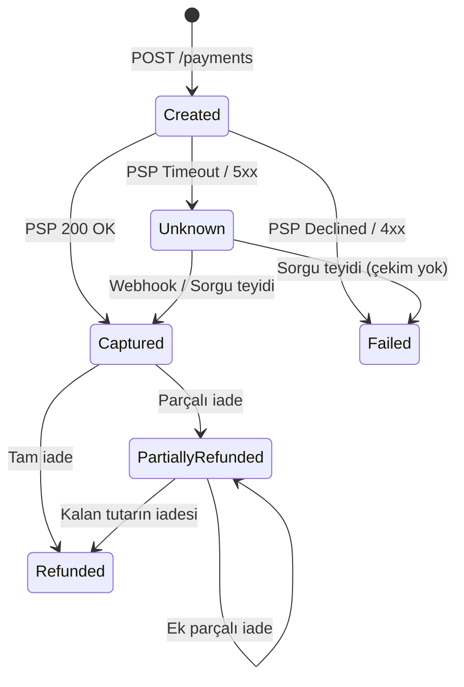

# Domain Notları

## Modüller ve Tutarlılık Sınırları
Sistem tek bir PostgreSQL veritabanı üzerinde modül bazlı şema ayrımıyla çalışır (`identity`, `payments`, `ledger`, `reconciliation`, `payouts`, `notifications`, `fx`, `copilot`). Modüller birbirinin tablosuna doğrudan sorgu atamaz, sadece `.Contracts` projeleri üzerinden haberleşir.

İki ana akışta farklı tutarlılık modeli uygulanır:
- Ödeme onayı (`Payments` -> `Ledger` / `Notifications`): Asenkron çalışır. `Payments` ödemeyi `Captured` yaptığında aynı transaction içinde Outbox tablosuna kayıt bırakır. `Pending` bakiye o saniye çekilemediği için aradaki kısa gecikme sorun yaratmaz.
- Hakediş çekimi (`Payouts` -> `Ledger` -> `Bank`): Bakiye kontrolü ve blokaj (`Available` -> `Reserved`) bellek içinde senkron yapılır; bakiye yetersizse istek anında reddedilir (`422`). Dış banka EFT çağrısı ise açık transaction tutmamak için blokaj sonrasında Outbox + Worker üzerinden asenkron yürütülür.

## Ödeme Durum Makinesi

Temel kurallar:
- PSP çağrısında timeout alındığında durum `Failed` değil `Unknown` olur; aksi halde müşteri tekrar deneyip mükerrer çekim yaşayabilir.
- Zaten `Captured` olan bir ödemeye PSP'den ikinci kez aynı webhook gelirse hata fırlatılmaz, yeni event üretmeden `200 OK` dönülür (idempotent no-op).
- `Failed` ve `Refunded` son (terminal) durumlardır, kayıt silinmez. `Failed` kalmış bir işleme sonradan PSP tahsilat bildirimi gelirse durum sessizce `Captured` yapılmaz; mutabakat modülüne uyuşmazlık (`UnexpectedCaptureDiscrepancy`) kaydı düşülür.

## Çift Kayıtlı Defter (Double-Entry Ledger)
`ledger.journal_entries` ve `ledger.entries` tabloları append-only çalışır (`UPDATE` / `DELETE` yapılmaz, düzeltmeler ters kayıtla atılır). Her fişte borç ve alacak toplamı eşit olmak zorundadır (`SUM(Debit) == SUM(Credit)`).

Kullanılan hesaplar:
- Varlık hesapları (artışı `Debit`): `PspReceivable`, `BankSettlement`
- Yükümlülük ve gelir hesapları (artışı `Credit`): `MerchantPending`, `MerchantAvailable`, `MerchantReserved`, `PlatformFeeRevenue`

1.000 TL satış (%2,5 = 25 TL komisyon) örneği:

| Aşama | Debit | Credit |
| --- | --- | --- |
| Capture | `PspReceivable` 1.000 | `MerchantPending` 975, `PlatformFeeRevenue` 25 |
| Banka takası | `BankSettlement` 1.000 | `PspReceivable` 1.000 |
| Mutabakat / valör çözümü | `MerchantPending` 975 | `MerchantAvailable` 975 |
| Payout blokajı | `MerchantAvailable` 975 | `MerchantReserved` 975 |
| Payout EFT onayı | `MerchantReserved` 975 | `BankSettlement` 975 |
| İade (komisyon iadesiz) | `MerchantAvailable` / `Pending` 1.000 | `PspReceivable` 1.000 |

İadelerde komisyon iade edilmez, tutarın tamamı üye işyeri bakiyesinden düşülür.

Milyonlarca satırda her seferinde `SUM` almamak için `ledger.accounts` tablosunda güncel `balance` kolonu tutulur. Tutarsızlık ve lost update olmaması için `entries` satırları ile `accounts.balance` aynı DB transaction'ı içinde (`xmin` / satır kilidi ve `CHECK (balance >= 0)` kısıtıyla) güncellenir.
