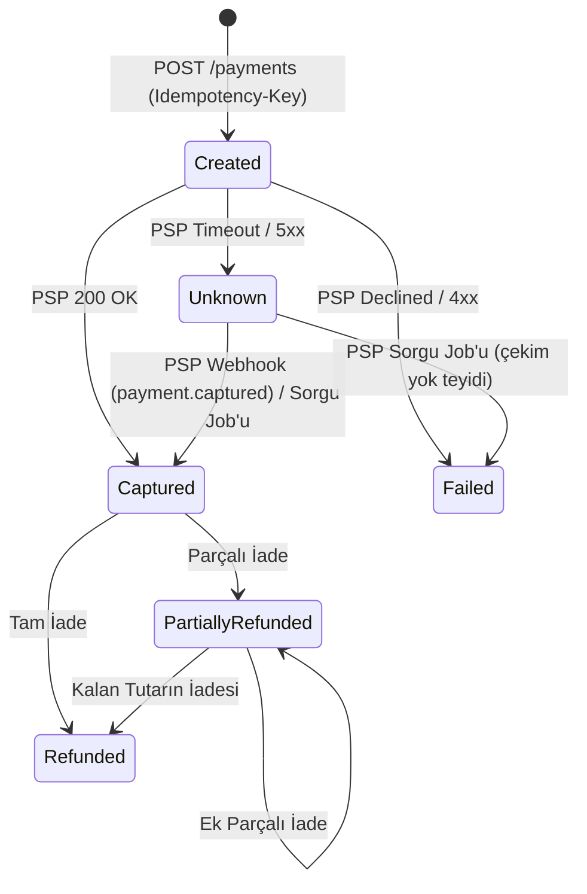

# LedgerFlow — Domain Tasarımı

Bu doküman, Faz 0'da kararlaştırılan bounded context sınırlarını, ödeme yaşam döngüsünü ve çift kayıtlı defter (double-entry ledger) kurallarını tanımlar.

---

## 1. Bounded Context Sınırları ve Tutarlılık Modeli

Tek bir PostgreSQL veritabanı içinde her modül kendi şemasına sahiptir; modüller arası doğrudan tablo `JOIN`'i veya `DbContext` paylaşımı yasaktır (`NetArchTest` ile zorunlu kılınır). Bir modül diğerinin yalnızca `<Module>.Contracts` projesini referans alabilir.

| Modül | DB Şeması | Sorumluluk |
| --- | --- | --- |
| `Identity` | `identity` | Kullanıcılar, Merchant (tenant) tanımları, roller, JWT / API Key / Cookie kimlik doğrulama |
| `Payments` | `payments` | Ödeme yaşam döngüsü, `Idempotency-Key`, PSP entegrasyonu ve gelen PSP webhook'ları |
| `Ledger` | `ledger` | Çift kayıtlı yevmiye defteri (`append-only`) ve Merchant bakiye hesapları |
| `Reconciliation` | `reconciliation` | PSP settlement CSV'si + banka ekstresi + iç defter üçlü eşleştirmesi ve uyuşmazlık (`Discrepancy`) yönetimi |
| `Payouts` | `payouts` | Merchant hakediş çekim talepleri ve banka EFT çıkışları |
| `Notifications` | `notifications` | Merchant'lara giden imzalı outbound webhook'lar, retry ve DLQ |
| `FX` | `fx` | Döviz kuru sağlayıcı entegrasyonu, önbellek ve fallback |
| `AICopilot` | `copilot` | Tenant izolasyonlu RAG, uyuşmazlık analizi, e-posta sınıflandırma ve insan onaylı aksiyon araçları |

### Modüller Arası İletişim Kararı (Hibrit Model)
- **Capture Akışı (`Payments` → `Ledger`, `Notifications`):** **Asenkron (Outbox + Kuyruk).** Müşteri ödemesi onaylandığında `Payments` kendi tablosunu ve Outbox kaydını yazar; `Ledger` ve `Notifications` olayı kuyruktan tüketir. `Pending` bakiye anında çekilemeyeceği için *eventual consistency* finansal risk oluşturmaz.
- **Payout Akışı (`Payouts` → `Ledger` → `Bank`):** **Senkron Blokaj + Asenkron EFT.**
  1. `POST /payouts` anında `Payouts`, `ILedgerModule` sözleşmesi üzerinden **senkron in-process** çağrı ile bakiyeyi kontrol edip bloke eder (`MerchantAvailable` → `MerchantReserved`). Bakiye yetersizse anında `422 Unprocessable Entity` döner; gereksiz Request-Reply Saga karmaşasından kaçınılır.
  2. Dış `Bank Simulator` EFT çağrısı asla açık bir DB transaction'ı içinde yapılmaz; blokaj sonrası **Outbox + Worker** ile asenkron yürütülür. EFT başarılı olursa `MerchantReserved` kapatılır, başarısız olursa ters kayıtla `MerchantAvailable`'a iade edilir.

---

## 2. Ödeme Durum Makinesi (`Payment` State Machine)

### Üretim Kuralları (Invariants)
1. **Timeout ≠ Başarısız:** PSP çağrısında ağ zaman aşımı (`Timeout`) veya `5xx` alındığında durum `Failed` değil **`Unknown`** olur; aksi halde müşteri tekrar dener ve çifte tahsilat (*double charge*) yaşanır.
2. **Idempotent Webhook İşleme:** Zaten `Captured` olan bir ödemeye tekrar `payment.captured` webhook'u gelirse hata fırlatılmaz; **idempotent no-op** uygulanır (ikinci kez Outbox olayı üretilmez) ve PSP retry fırtınasını önlemek için `200 OK` dönülür.
3. **Terminal Durumlar (`Failed`, `Refunded`):** `Failed` terminaldir ve kayıt asla silinmez. `Failed` olarak kapanmış bir ödemeye sonradan PSP tahsilat bildirimi (geç webhook veya ertesi gün CSV satırı) gelirse durum sessizce `Captured`'a çevrilmez; `Reconciliation` modülüne **`UnexpectedCaptureDiscrepancy`** fırlatılır ve otomatik iade / operasyon incelemesi tetiklenir.

---

## 3. Çift Kayıtlı Defter (`Double-Entry Ledger`) ve Bakiye Modeli

### Temel İlkeler
1. **Append-Only:** `ledger.journal_entries` ve `ledger.entries` tablolarında `UPDATE` ve `DELETE` yapılmaz. İptal ve düzeltmeler ters yönlü yeni bir `JournalEntry` ile kaydedilir.
2. **Sıfır Toplam Kuralı:** Her `JournalEntry` içindeki borç (`Debit`) ve alacak (`Credit`) bacaklarının toplamı birbirine eşit olmak zorundadır (`SUM(Debit) == SUM(Credit)`).

### Hesap Planı (Chart of Accounts)
| Hesap | Tür | Artış Yönü | Açıklama |
| --- | --- | --- | --- |
| `PspReceivable` | Varlık (Asset) | `Debit` | PSP'den tahsil edilecek brüt alacak |
| `BankSettlement` | Varlık (Asset) | `Debit` | Şirket banka hesabındaki gerçek nakit |
| `MerchantPending:{MerchantId}` | Yükümlülük (Liability) | `Credit` | Mutabakat/valör bekleyen bloke üye işyeri bakiyesi |
| `MerchantAvailable:{MerchantId}` | Yükümlülük (Liability) | `Credit` | Çekilebilir üye işyeri bakiyesi (`CHECK (balance >= 0)`) |
| `MerchantReserved:{MerchantId}` | Yükümlülük (Liability) | `Credit` | Payout süresince bloke tutulan bakiye |
| `PlatformFeeRevenue` | Gelir (Revenue) | `Credit` | Platform komisyon geliri |

### Örnek Akış (1.000,00 TRY Satış, %2,5 = 25,00 TRY Komisyon)
| Olay | `Debit` (Borç) | `Credit` (Alacak) |
| --- | --- | --- |
| **1. Capture** | `PspReceivable` 1.000 | `MerchantPending` 975 + `PlatformFeeRevenue` 25 |
| **2a. Banka Takası (Settlement)** | `BankSettlement` 1.000 | `PspReceivable` 1.000 |
| **2b. Mutabakat / Valör Çözümü** | `MerchantPending` 975 | `MerchantAvailable` 975 |
| **3a. Payout Blokajı (Senkron)** | `MerchantAvailable` 975 | `MerchantReserved` 975 |
| **3b. Payout EFT Onayı (Asenkron)** | `MerchantReserved` 975 | `BankSettlement` 975 |
| **İade (Komisyon İadesiz Politika)** | `MerchantAvailable` (veya `Pending`) 1.000 | `PspReceivable` 1.000 |

> **İade Politikası:** Müşteri iadelerinde platform komisyonu (`PlatformFeeRevenue`) üye işyerine iade edilmez; iade tutarının tamamı üye işyeri bakiyesinden karşılanır (`balance >= iade tutarı` kontrolü ile `CHECK (balance >= 0)` korunur).

### Performans ve Eşzamanlılık Stratejisi (`SUM` vs. `balance` Kolonu)
- `ledger.entries` tablosu milyonlarca satıra ulaşacağından her bakiye kontrolünde `SUM(...)` çalıştırılmaz.
- Gerçek kaynak (`Source of Truth`) `ledger.entries` tablosu kalmak şartıyla, `ledger.accounts` tablosunda güncel `balance` projeksiyon kolonu tutulur.
- Güncellik kaybını ve *Lost Update* anomalisini önlemek için `ledger.entries` eklemesi ve `ledger.accounts.balance` güncellemesi **aynı PostgreSQL transaction'ı içinde**, atomik satır kilidi / `xmin` versiyon kontrolü ve `CHECK (balance >= 0)` kısıtıyla birlikte yapılır. Gece mutabakat sürecinde `SUM` ile `balance` çapraz doğrulanır (*self-auditing*).
